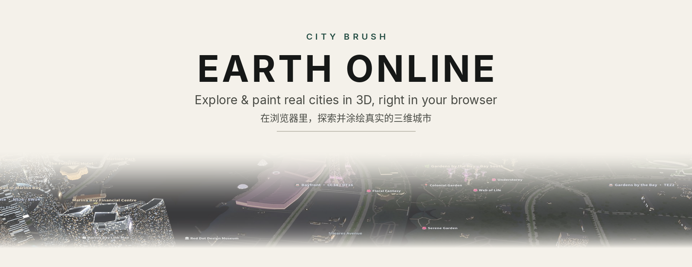
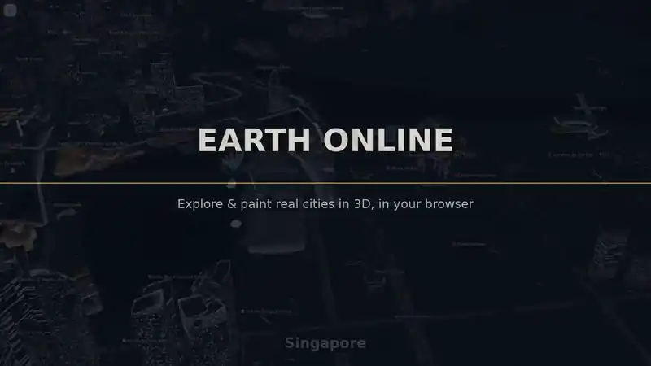
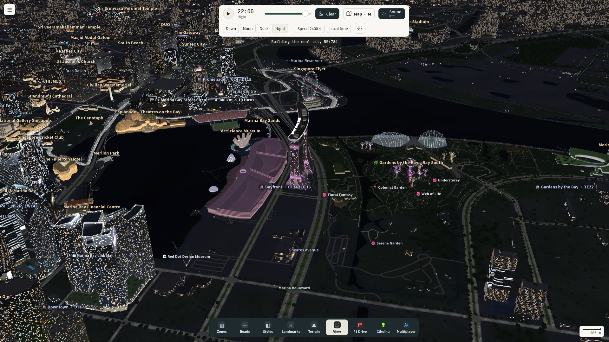
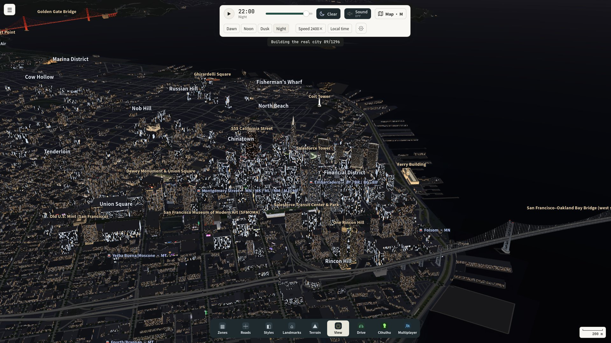
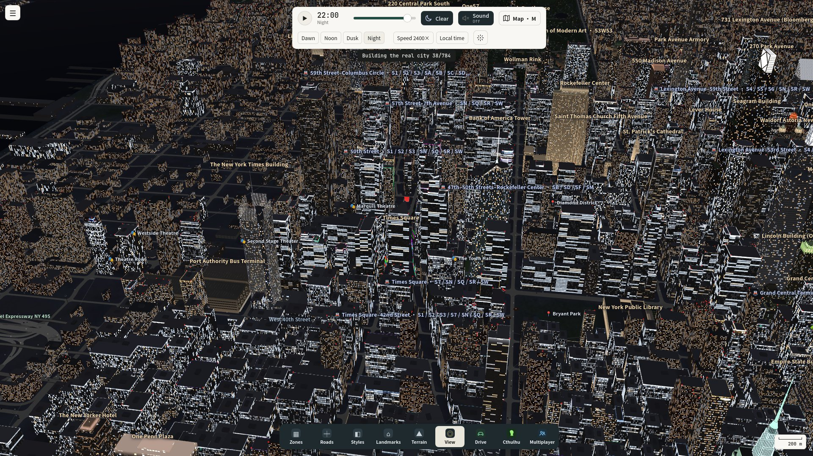
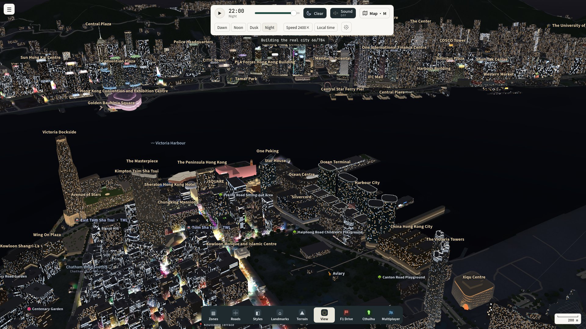
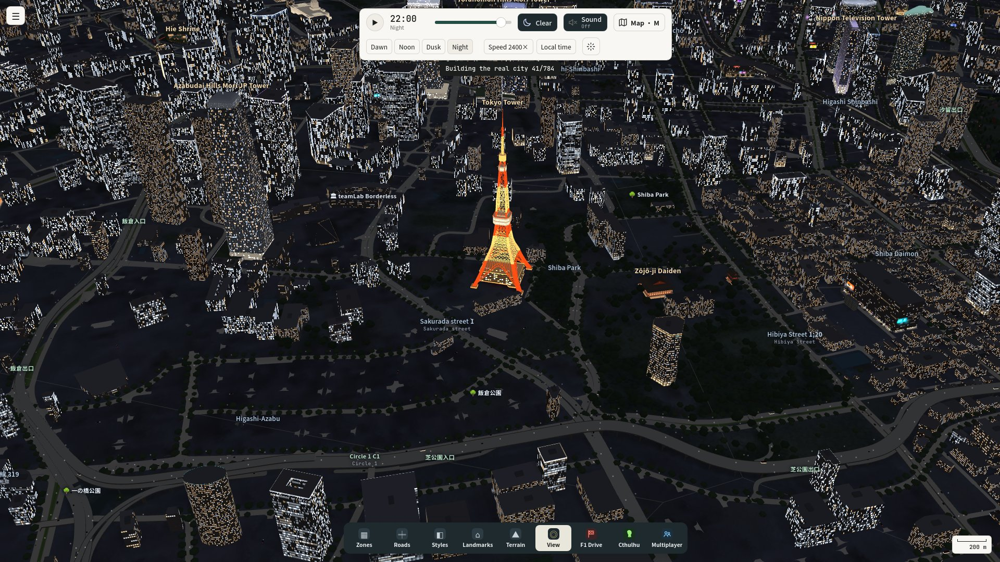
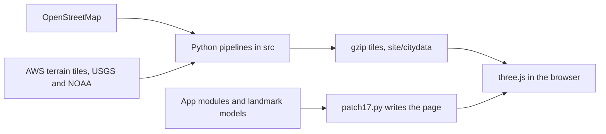

<p align="center">
  <picture>
    <source media="(prefers-color-scheme: dark)" srcset="docs/media/banner-dark.png">
    <source media="(prefers-color-scheme: light)" srcset="docs/media/banner-light.png">
    
  </picture>
</p>

<p align="center">
  <a href="LICENSE"></a>
  <a href="DATA_LICENSE"></a>
  <a href="https://earth-online-wsammes-projects.vercel.app"></a>
  <a href="https://github.com/Wsamme/EARTH_ONLINE/stargazers"></a>
  <a href="https://github.com/Wsamme/EARTH_ONLINE/commits/main"></a>
  
</p>

<p align="center">
  <a href="https://earth-online-wsammes-projects.vercel.app"><b>Live demo</b></a>
  &nbsp;·&nbsp;
  <a href="docs/media/earth-online-promo.mp4"><b>Video</b></a>
  &nbsp;·&nbsp;
  <a href="#how-it-works"><b>Docs</b></a>
  &nbsp;·&nbsp;
  <a href="CONTRIBUTING.md"><b>Contributing</b></a>
</p>

<p align="center">
  <i>在浏览器里，探索并涂绘真实的三维城市。</i>
</p>

Five real cities, at 1:1, in the browser. Roads, rail, buildings, terrain and water come from OpenStreetMap and public terrain. You orbit them, paint over them, drive them, and fly them. The page is a static site: three.js r128, no install, no account.

## Demo

GitHub does not play an `.mp4` inside a README. The clip below is an animated WebP made from the promo, so it plays on github.com and on a phone. Click it for the full video (about 30 seconds, 1920×1080).

<p align="center">
  <a href="docs/media/earth-online-promo.mp4">
    
  </a>
</p>

<p align="center">
  <a href="docs/media/earth-online-promo.mp4"><b>Full video</b></a>
  &nbsp;·&nbsp;
  <a href="docs/media/earth-online-promo-square.mp4">Square cut</a>
</p>

If animation is turned off in your GitHub accessibility settings, the preview sits on a still frame. The sentence above is the same tour: Singapore, the Bay, New York, Hong Kong, then Tokyo and a brush stroke in the full file.

### Five cities at night

Each still links to that city’s live page.

<table>
  <tr>
    <td align="center" colspan="2" width="33%">
      <a href="https://earth-online-wsammes-projects.vercel.app/"></a><br>
      <a href="https://earth-online-wsammes-projects.vercel.app/"><b>Singapore</b></a><br>
      <sub>Marina Bay, the Flyer, Gardens by the Bay</sub>
    </td>
    <td align="center" colspan="2" width="33%">
      <a href="https://earth-online-wsammes-projects.vercel.app/bay.html"></a><br>
      <a href="https://earth-online-wsammes-projects.vercel.app/bay.html"><b>San Francisco Bay</b></a><br>
      <sub>Downtown, the Golden Gate, the Bay Bridge</sub>
    </td>
    <td align="center" colspan="2" width="33%">
      <a href="https://earth-online-wsammes-projects.vercel.app/nyc.html"></a><br>
      <a href="https://earth-online-wsammes-projects.vercel.app/nyc.html"><b>New York</b></a><br>
      <sub>Midtown and the five boroughs</sub>
    </td>
  </tr>
  <tr>
    <td align="center" colspan="3" width="50%">
      <a href="https://earth-online-wsammes-projects.vercel.app/hk.html"></a><br>
      <a href="https://earth-online-wsammes-projects.vercel.app/hk.html"><b>Hong Kong</b></a><br>
      <sub>Victoria Harbour, the island and Kowloon</sub>
    </td>
    <td align="center" colspan="3" width="50%">
      <a href="https://earth-online-wsammes-projects.vercel.app/tyo.html"></a><br>
      <a href="https://earth-online-wsammes-projects.vercel.app/tyo.html"><b>Tokyo</b></a><br>
      <sub>Tokyo Tower, the wards, Fuji on the horizon</sub>
    </td>
  </tr>
</table>

## Features

- **Five real cities.** Singapore, the San Francisco Bay Area, New York, Hong Kong and Tokyo, each on its own page, each built from real roads and building footprints.
- **Paint.** Zones, roads, architectural styles, landmarks and terrain. The brush is a real change on the map, with undo.
- **Look around.** Orbit, pan, zoom, a tour, labels, and a tilt-shift that leaves one band sharp.
- **Time of day.** Dawn, noon, dusk, night, or play the day. Windows and street lamps follow the clock.
- **Weather.** Clear, cloud, haze, rain and storm on the time bar. The Bay Area adds its fog. New York adds fog and snow.
- **Drive and race.** Free drive on the real streets, or a race with a grid of AI cars. Flying (runways and helipads) and a short fireworks show live in the same tray.
- **Cthulhu.** A single-player mode: a creature comes out of the water and hunts the car. An army on the roads tries to slow it down. It does not need a server.
- **Phone.** One finger orbits, two fingers pan and pinch. Far from the camera the city is drawn as coarse boxes, and the nearby blocks stay in full detail. The page itself does not scroll or zoom.
- **Credit stays up.** “© OpenStreetMap contributors” and “Terrain · USGS / NOAA” stay in the corner when the rest of the interface is hidden.

The generator (plan, districts, traffic, terrain tools, seeds, presets) is still there, behind **Advanced**, collapsed until you open it.

## Cities

| City | Live | Page in `site/` | What the source builds |
|---|---|---|---|
| Singapore | [Open](https://earth-online-wsammes-projects.vercel.app/) | `index.html` | The island: roads, buildings, coastline, reservoirs. A 56 km square. |
| San Francisco Bay | [Open](https://earth-online-wsammes-projects.vercel.app/bay.html) | `bay.html` | The bay, about 1.3 million building footprints, the bridges and the downtown HQs. |
| New York | [Open](https://earth-online-wsammes-projects.vercel.app/nyc.html) | `nyc.html` | The five boroughs, plus Jersey City and Newark. About 1.65 million footprints. |
| Hong Kong | [Open](https://earth-online-wsammes-projects.vercel.app/hk.html) | `hk.html` | Hong Kong Island, Kowloon, the New Territories, Lantau and the islands. Shenzhen is context, not the subject. |
| Tokyo | [Open](https://earth-online-wsammes-projects.vercel.app/tyo.html) | `tyo.html` | The 23 wards out through Kawasaki, Yokohama and Saitama, Tokyo Bay, and Mount Fuji on the horizon. About 3.5 million footprints. |

Every city opens in View. The buttons in the corner switch among the five pages in the same folder.

## Quick start

`site/` is a static site. There is no build step to run it.

```bash
cd site
python3 -m http.server 8000
```

Open <http://localhost:8000>. Serve the folder; opening the HTML file directly will not load the map tiles.

To put it on Vercel: import the repo, set **Root Directory** to `site`, framework **Other**, and leave the build command empty. `site/vercel.json` only sets cache headers for the `.bin` tiles, `ground.webp`, and the app scripts.

The map files are raw gzip, `site/<city>data/*.bin`, up to about 10 MB each and about 188 MB together. The page asks for `.bin` first.

### Rebuild a page

From `src/`:

```bash
CITY=sg python3 sgreal/patch17.py city-brush-v16.html ../site/index.html
```

`CITY` is `sg`, `bay`, `nyc`, `hk` or `tyo`. That writes the matching HTML page and its `app.js` (or `*-app.js`). The script finds `src/` from its own path. Rebuilding a page does not regenerate the map tiles.

## How it works



- `src/city-brush-v16.html` is the base app: the brush, the camera, the time of day, the dock.
- `src/sgreal/patch17.py` concatenates the city engine, the landmark modules and the extras (drive, fly, weather, Cthulhu, the multiplayer client), then lifts the big script out into a sibling `.js` file.
- `src/sgreal/`, `src/bayreal/`, `src/nycreal/`, `src/hkreal/` and `src/tyoreal/` turn OpenStreetMap and AWS terrain tiles into the `.bin` files. Hong Kong, New York, Tokyo and the Bay each have a pipeline note in that folder.
- `src/lm*/`, `src/bay/`, `src/nyc/`, `src/hk/` and `src/tyo/` are the feature modules and the landmark models. The models are original and simplified. Hong Kong’s signs follow the size and colour of real signs, and every name on them is invented.
- On a phone the viewer keeps full buildings near the camera and coarse boxes farther out, and it widens or narrows that radius from the frame time. On a desktop every tile is full detail.
- The corner credit is in the HTML shell, so a rebuild keeps it. Hiding the panel, or pressing `H`, does not hide it.

## Controls

The copy on the page is English.

### Mouse and touch

| | |
|---|---|
| Left drag | Paint, in a paint tool |
| Right drag, scroll wheel | Pan, zoom |
| Space, held | Orbit, even while a paint tool is selected |
| One finger | Orbit in View. Paint when a brush is selected |
| Two fingers | Pan and pinch-zoom |

While driving, the phone puts steering on the left and the pedals on the right.

### Keyboard

| Key | Action |
|---|---|
| `W` `A` `S` `D`, arrows | Move |
| `Q` `E` | Turn |
| `Z` `X`, `+` `−` | Zoom |
| `T` `G` | Tilt |
| `Shift` | Faster |
| `H` | Hide the interface. Press again, or `Esc`, to bring it back. The map credit stays. |
| `L` | Labels |
| `O` | Tour |
| `M` | Tilt-shift |
| `1`–`9` | Tools |
| `[` `]` | Brush size |
| `R` | Rotate the landmark you are placing |
| `Ctrl` or `Cmd` + `Z` | Undo |
| `Esc` | Leave the tour, or show the interface |

In the car: `W` / `S` throttle and brake, `A` / `D` steer, `Space` handbrake, `C` camera, `R` reset, `Esc` exit, `N` navigation.

### The chrome

- **‹** hides the whole top-left panel. **☰** brings it back. A portrait phone starts collapsed. The choice is stored in `localStorage` (`cb-panel-away`).
- **Advanced** opens the generator. It starts collapsed.
- The time bar is Dawn, Noon, Dusk, Night, plus play and the weather button.
- The dock is Zones, Roads, Styles, Landmarks, Terrain, View, then F1 Drive, Cthulhu and Multiplayer.

## Roadmap

These are gaps in the repo today, not a promise of what ships next.

- The multiplayer tab is a client. It wants a WebSocket game server (rooms, up to 12 people, race / city race / escape / cruise). That server is not in this repository, and the static demo does not host rooms.
- The water is a flat surface. It does not reflect the skyline.
- Phone behaviour is tuned in a desktop browser’s mobile viewport. A pass on a real iPhone is still the check that matters.

## Contributing

See [CONTRIBUTING.md](CONTRIBUTING.md). Short version: serve `site/`, keep the OpenStreetMap credit on the map, and don’t commit generated caches or a machine-specific path.

## License and attribution

Two licences, on purpose.

**Code** is MIT, copyright (c) 2026 Aster Wang. That covers the pages, the programs in `src/`, and the original landmark models. See [LICENSE](LICENSE).

**The map is not MIT.** `site/<city>data/` is a database derived from OpenStreetMap, under the Open Database License (ODbL) 1.0. Credit it as “© OpenStreetMap contributors”, and link <https://www.openstreetmap.org/copyright> when you can. If you share a derived database, offer it under the ODbL too. A picture of the 3D city can have its own licence; the credit still has to be there. Details, including the Singapore Overture / HDB3D note, are in [DATA_LICENSE](DATA_LICENSE). The files on disk are raw gzip `.bin`. `DATA_LICENSE` still mentions the earlier base64 `.txt` name; it is the same database.

**Terrain** is AWS Terrain Tiles (Mapzen / Tilezen terrarium): USGS 3DEP for San Francisco and New York, SRTM and GMTED2010, and NOAA ETOPO1 for the sea floor.

> 3DEP, SRTM and GMTED2010 terrain data courtesy of the U.S. Geological Survey. ETOPO1 terrain data courtesy of the U.S. National Oceanic and Atmospheric Administration.

The running map repeats both credits in the corner, including while the rest of the interface is hidden. Leave them there.

three.js r128 is loaded from a CDN and stays under its own MIT licence. Noto Sans SC and JetBrains Mono come from Google Fonts and are not in this repository.

## Acknowledgements

- [OpenStreetMap](https://www.openstreetmap.org/copyright) contributors
- U.S. Geological Survey, for 3DEP, SRTM and GMTED2010
- U.S. National Oceanic and Atmospheric Administration, for ETOPO1
- [AWS Open Data](https://registry.opendata.aws/terrain-tiles/) and [Tilezen](https://github.com/tilezen/joerd/blob/master/docs/attribution.md), for the terrain tiles
- Overture Maps and the HDB3D attributes used while the Singapore buildings were built. See `DATA_LICENSE` before you pass those on
- [three.js](https://github.com/mrdoob/three.js/)

## Star history

<a href="https://star-history.com/#Wsamme/EARTH_ONLINE&Date">
  <picture>
    <source media="(prefers-color-scheme: dark)" srcset="https://api.star-history.com/svg?repos=Wsamme/EARTH_ONLINE&type=Date&theme=dark">
    <source media="(prefers-color-scheme: light)" srcset="https://api.star-history.com/svg?repos=Wsamme/EARTH_ONLINE&type=Date">
    
  </picture>
</a>
